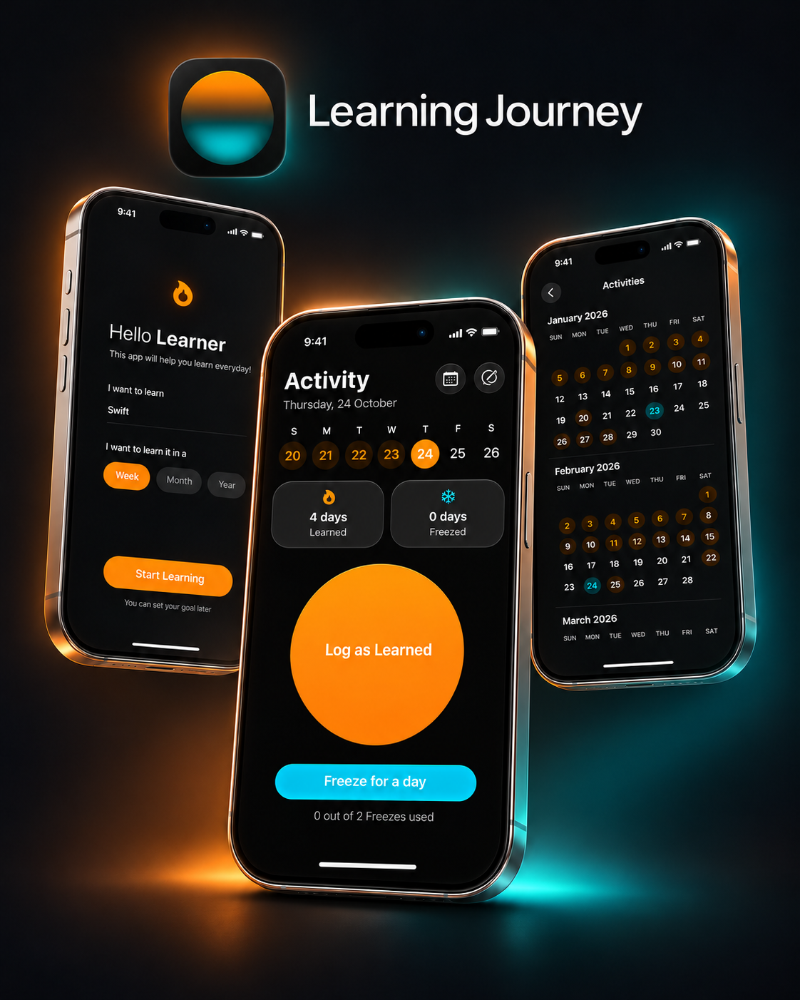

# LearningTracker

An iOS app that helps users build a daily learning habit and track their progress toward a goal. Users choose a topic and goal duration, then mark each day as a learning day or a freeze day to track their activity toward that goal.

## Features

- Choose a specific learning goal.
- Set a goal duration: one week, one month, or one year.
- Log a day as Learned or use a Freeze.
- View learned and frozen days in a calendar.
- View the number of Learned and Frozen days.
- Update the learning goal. Updating the goal resets the current streak.
- Set a new goal after the current goal is completed or not reached.

## Daily Rules

- A new day starts at 12:00 AM.
- Each day can be marked as Learned or Frozen.
- The number of available freezes depends on the goal duration:
  - Week: 2 freezes.
  - Month: 8 freezes.
  - Year: 96 freezes.
- The goal is deleted if 32 hours pass without logging a day as Learned or using a Freeze.
- Learned days appear in muted orange, and frozen days appear in muted blue.
- The current day is highlighted with a solid orange or blue color.

## App Screens

1. **Onboarding:** Choose a learning topic and goal duration.
2. **Activity:** View the current week and log a day as Learned or Frozen.
3. **Activities Calendar:** View previous learned and frozen days.
4. **Update Goal:** Change the topic or duration. Updating the goal resets the streak.
5. **Goal Result:** See whether the goal was completed or not reached, then set another goal.

## Technologies Used

- Swift
- SwiftUI
- Combine

- Claude
- ChatGPT
